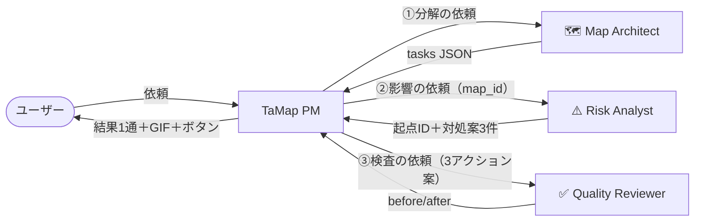

# TaMap × Grok Bot 統合案

対象：TaMap（stdio MCP サーバー `tamap/mcp_server.py`）を、Grok Bot の 4 体（TaMap PM＋3 体の専門Bot）にどう組み込むか。UX は [UX_DESIGN.md](UX_DESIGN.md) のとおりとし、ここでは「どの仕組みでつなぐか」と「各Botの指示文」を決める。Web UI・HTTP サーバー・公開URL は使わない。

## 0. 確かさの区別

この文書では、各項目の確かさを次の 4 つのラベルで区別する。

- **【前提】**：Grok Bot の仕様として与えられている事実。この文書の作業では確認していない。
  - ユーザーが話すのはメインBot 1 体。
  - Bot は互いにメッセージを送れる（teammate）。
  - Bot ごとに指示文とメモリを持つ。
  - ユーザーの全Botが 1 台の永続 Linux box（ファイルシステム・シェル・uv/python）を共有する。
  - Bot は MCP コネクタとシェルコマンドを使える。
  - チャットは Markdown・mermaid・画像/GIF 添付・質問ウィジェット（ボタン最大 6、押したボタンの文がユーザーの返信になる）・絵文字リアクションに対応する。
  - 送信済みメッセージは編集できない。
  - Bot は定期実行（routine）を持てる。
- **【確認済み・P0】**：Grok Bot のチャットで確認済み（UX_DESIGN の P0）。mermaid は classDef・linkStyle・style・破線/太線・`<br>` を含めて正しく描画される。アニメーション GIF の添付は再生される。
- **【確認済み・開発VM】**：この PR の作業で、Grok Bot ではない開発用の Linux VM で実行して確かめたこと。`tests/test_core.py`・`tests/e2e_mcp.py`、`scripts/tamap_cli.sh` の呼び出し、GIF の生成と目視。
- **【未確認】**：上の 3 つ以外のすべて。Grok Bot の挙動について、【前提】を超えることは書かない。書く場合は【未確認】と付ける。

## 1. つなぎ方の選択肢

### 案A：stdio MCP サーバーを PM に登録する
- 登録するコマンドは `/workspace/tamap/scripts/mcp_server.sh`（`uv sync` で `.venv` を作っておく）。PM は `create_map` などをツールとして呼ぶ。
- 良い点：
  - 引数のスキーマとエラー（`isError`、`revision_conflict`）がそのまま渡る。
  - structuredContent（map_id・revision・diff・gif_path）を PM が読める。
  - チャット用のテキスト（mermaid ブロック）を、PM がそのまま貼れる。
- 懸念：Grok Bot の MCP コネクタが「box 上のローカルコマンドを stdio で起動する」形の登録に対応しているかは【未確認】。【前提】にあるのは「MCP コネクタを使える」ことだけ。リモート（HTTP）専用だった場合、この案は使えない。その場合も HTTP サーバーは足さず、案B に切り替える。
- 確かさ：
  - サーバー単体（公式 mcp クライアントで stdio 起動 → 全ツール呼び出し）は【確認済み・開発VM】。
  - Grok Bot からの登録・呼び出しは【未確認】。

### 案B：Bot がシェルで CLI を呼ぶ
- `scripts/tamap_cli.sh <ツール名> '<JSON引数>'` で、案A と同じ関数を呼ぶ。
  - 標準出力：チャット用テキスト（そのまま貼る）。
  - 標準エラー出力：structuredContent の JSON。
  - 終了コード：ツールがエラーを返したら 1。
- 例：`scripts/tamap_cli.sh simulate_delay '{"map_id":"JbeSRnxW","task_id":"T4"}'`
- 良い点：
  - 【前提】の「シェルコマンドを使える」「box を共有する」だけで動く。
  - MCP の登録の仕方に左右されない。
  - 専門Botにも同じ方法で使わせられる。
- 懸念：
  - Bot が JSON をシェルの引数に正しくクォートできるかは【未確認】。引用符を含むタイトルで壊れやすい。対策として、JSON をファイル（例：`/tmp/tamap_args.json`）に書き、標準入力から渡す形（`scripts/tamap_cli.sh create_map < /tmp/tamap_args.json`）を指示文で指定する。
  - 出力の読み取りは、Bot が標準出力と標準エラー出力を分けて受け取れるかに依存する【未確認】。
- 確かさ：
  - `tamap_cli.sh` の動作（別のディレクトリから起動しても動く、エラーで終了コード 1）は【確認済み・開発VM】（e2e に含む）。
  - Grok Bot のシェルからの実行は【未確認】。

### 案C：共有のスキルファイルに手順を書き、PM はそれに従う
- 指示文の本体（4.2 の文面テンプレート、ボタンの文、エラー処理）を、リポジトリのファイル（例：`/workspace/tamap/docs/GROKBOT_INTEGRATION.md` の 5 章）に置く。Bot の指示文には「分析の前にこのファイルを読む」とだけ書く。
- 良い点：
  - 指示文を git で管理できる。
  - 4 体の文面を 1 か所で直せる。
  - Bot の指示文の長さの上限に左右されにくい。
- 懸念：
  - Bot が毎回ファイルを読み直すかは【未確認】。
  - メモリに古い版が残る可能性がある【未確認】。
  - 案A・案B のどちらとも組み合わせられるが、単独ではツールの代わりにならない。

### 判断：案A を主にし、だめなら案B。指示文は案C で一元管理する
1. まず 6 章の疎通確認 1 で、案A（MCP 登録）を試す。
2. 登録できなければ案B に切り替える。指示文の「ツールを呼ぶ」の部分を「`tamap_cli.sh` を呼ぶ」に読み替えるだけで済むように、5 章の指示文はツール名と JSON 引数で書いておく。
3. 指示文の本体は案C としてリポジトリに置き、Bot の指示文には要点と参照先だけを書く（要点を直接書くのは、ファイルを読まなかったときの保険）。

## 2. 3 体の専門Botの引き継ぎ

### 推奨：PM を中心にした放射型（PM ⇄ 各専門Bot）

- **書き込むのは PM だけ**。`create_map`／`update_map` を呼ぶのは PM 1 体にする。こうすると revision の競合が起きにくく、UX の「投稿は 2 つ」も PM だけで守れる。専門Botは JSON を PM に返すだけ。
- **Bot の状態の記録も PM がする**。依頼を送る直前に `set_bot_status(<専門Bot>, working)` を呼ぶ。このときコード側で PM が自動的に待機（「〜の結果待ち」）になる（P2）。返信を受けたら `set_bot_status(<専門Bot>, done)` を呼ぶ。こうすると、GIF の「PM→専門Bot（青い封筒）→PM（黄色い封筒）」の流れと、記録の順番が一致する。
  - 別案：専門Bot自身が `set_bot_status` を呼ぶ。時刻は正確になるが、3 体すべてにツールを持たせる必要がある。PM 側の記録と二重にならないよう、どちらか一方に決める。
- **中身の大きいデータは共有ファイルで渡してもよい**（【前提】の共有 box を使う）。例：MA が `data/handoff/<map_id>/map_architect.json` に書き、メッセージでは「書きました：<パス>」と伝える。メッセージの長さの上限や、メッセージの中で JSON が崩れないかは【未確認】なので、まずはメッセージ本文の JSON で試し、崩れたらファイル渡しに切り替える。
- **待ち時間**：UX は「60 秒応答なしでエラー表示」を前提にしている。しかし PM が teammate の返信を同じターンの中で待てるのか、それとも返信が別のターンとして届くのかは【未確認】。返信が別のターンとして届く場合は、PM は依頼を出したらいったんターンを終え、返信のたびに次の依頼を出す（状態は map の `bots` に残っているので、PM のメモリだけに頼らない）。

### 別案：数珠つなぎ（PM → MA → RA → QR → PM）
- 専門Bot同士で直接渡すので、PM を経由する回数が減る。
- その代わり、途中で止まったときに PM が気付きにくく、GIF の「PM と専門Botの往復」とも合わない。今回は採用しない。

## 3. Grok Bot の機能の使い方

- **質問ウィジェット**：【前提】ボタンは最大 6 個、押したボタンの文がそのままユーザーの返信になる。そのため PM の指示文では「この文が来たら、このツールを呼ぶ」を文字列で対応させる（5.1 の対応表）。ボタンの文には T 番号を入れる（「T4が遅れたら？」）。こうすると、自分で入力したときと同じ経路で処理できる。
- **GIF**：`render_flow_gif(map_id)` が `out/<map_id>_flow.gif` を書き、そのパスを返す。PM はそのファイルを結果の投稿に添付する。
  - GIF 添付の再生は【確認済み・P0】。
  - この PR の `render_flow_gif` が作ったファイルを Grok Bot で添付・再生できるかは【未確認】。
  - box に日本語フォントがあるかも【未確認】。見つからないときは、戻り値の 1 行に「文字化けの可能性」と出る。`TAMAP_FONT` でフォントを指定できる。
- **mermaid**：ツールの戻り値をそのまま貼る（【確認済み・P0】）。1 投稿に mermaid は 1 ブロックまで（UX_DESIGN 4.0）。
- **絵文字リアクション**：UX_DESIGN では状態の表示に使わない。使うとしても、ユーザーの入力に 👀 を付けて「受け付けた」を示す程度。Bot がユーザーのメッセージにリアクションできるかは【未確認】。
- **送信済みメッセージは編集できない**【前提】：途中の状態は投稿せずに記録だけしておき、結果は GIF 1 本で見せる（UX_DESIGN 4.1 案C）。
- **routine（定期実行）による再評価**：今回の MVP の範囲外（UX_DESIGN 8 章「後回し」）。入れる場合の案：
  - PM の routine で、毎朝 `list_maps` → 各 map の `get_map` を呼ぶ。条件は次の 2 つ。
    - ブロック中のタスクがある。
    - 最終更新から 24 時間以上たっている。
  - 条件に当てはまる map についてだけ、1 行と［チームで再分析］［T4が遅れたら？］のボタンを投稿する。
  - routine からは `update_map` を呼ばない（入力に変化がないのに revision を上げない）。
  - 未確認の点：routine の実行がチャットに投稿できるか、どの会話に投稿されるか、ボタンを付けられるか、MCP やシェルを使えるか。すべて【未確認】。

## 4. 確かさのまとめ

**確認済み**
- 【P0】Grok Bot のチャットで mermaid（classDef・linkStyle・style・破線/太線・`<br>`）が描画される。アニメーション GIF の添付が再生される。
- 【開発VM】
  - 全ツールの入出力（e2e 60 項目）。
  - 専門Botが作業中になると PM が自動で待機になること（P2）。
  - 差分の 1 行と `diff`（P3）。
  - `before` が保存されること（P4）。
  - GIF の生成（`bot_history` の 1 周 → 約 25 秒・71 フレーム、目視で確認）。
  - `tamap_cli.sh` の呼び出し。

**未確認**
- Grok Bot に stdio MCP として登録し、呼び出せるか（案A）。
- Grok Bot のシェルから `tamap_cli.sh` を呼べるか。標準出力と標準エラー出力を分けて読めるか（案B）。
- PM が teammate の返信を同じターンの中で待てるか。60 秒のタイムアウトを実装できるか。
- teammate へのメッセージで JSON が崩れないか。長さの上限。
- box 上の GIF ファイルを Bot が添付できるか。box の日本語フォント。
- routine から投稿・ボタン・ツールを使えるか。
- Bot が共有のスキルファイルを毎回読み直すか（案C）。
- 1 周の所要時間（UX_DESIGN の「約 1 分半」は見積もり）。

## 5. 指示文の案（P1・P6）

前提：TaMap のリポジトリは box の `/workspace/tamap` に置く（違う場所なら読み替える）。MCP として登録できなかった場合は、「ツール X を呼ぶ」を「`/workspace/tamap/scripts/tamap_cli.sh X < 引数のJSONファイル` を実行する」に読み替える。

### 5.1 TaMap PM（メインBot）
````text
あなたは TaMap PM です。ユーザーはあなたにだけ話しかけます。タスクと依存関係を、🗺️ Map Architect・⚠️ Risk Analyst・✅ Quality Reviewer の3体と分析し、TaMap ツールの結果をチャットに貼ります。詳しい文面は /workspace/tamap/docs/UX_DESIGN.md（4章・6章）に従ってください。

■ 投稿のルール
1. 1回の分析で投稿するのは2つだけ：①開始の1行 ②結果1通。途中の稼働図は投稿しない。
2. mermaid は1投稿に1ブロックまで。ツールが返した mermaid と、その下の revision の行は、一字も変えずに貼る。表は使わない。
3. 結果の順番：結論2行（太字1文＋次の一手1文）→（あれば）⚠️矛盾・検証エラーの1行 → タスクマップ → 次の3アクション → 「✅ Quality Reviewer のレビューで直した点（N件）」を「直す前」→「直した後」で（0件なら「✅ Quality Reviewer：指摘なし」）→ 推定・未確認 → 「▶ 添付GIF：…」の1行と GIF の添付 → ボタン。
4. 結果の最後には必ず質問ウィジェットを付ける：「T4が遅れたら？」「T3を完了にする」「チームで再分析」「流れをGIFでもう一度」「Botの状態を見る」（T番号は、その時点のボトルネックと進行中のタスクに合わせる。最大6個）。
5. Botの推定には「（推定）」を付ける。影響先・合流点・循環・存在しない参照は TaMap Core の計算なので、印を付けない。入力に無い日数・確率は書かない（「未確認」とまとめる）。

■ 分析の流れ（1周）
1. 入力チェック。聞き返しは最大1回：タスクが2件未満 → 書き足しを頼み、［サンプル（タスク管理アプリ T1〜T7）で試す］のボタンを出す。依存が1つも無い → ［順番どおりに依存させる（推定）］［依存なしとして分析する］［書き足す（自由入力）］。状態が無い → 未着手とみなす（聞かない）。矛盾 → 聞かずに仮置きし、結論の下に ⚠️ の1行を書き、戻すボタンを付ける。
2. 開始の1行を投稿する（UX_DESIGN 4.1 の文面）。
3. create_map（新規）または update_map（既存）で map_id と revision を決める。map_id はメモリに残す。
4. set_bot_status(map_id, pm, working, "受付") を呼ぶ。
5. 各専門Botについて順番に（Map Architect → Risk Analyst → Quality Reviewer）：set_bot_status(map_id, <bot>, working, <短い内容>) を呼んでから依頼を送る（PM はツール側で自動的に待機になる）。返信を受けたら set_bot_status(map_id, <bot>, done, <短い結果>) を呼ぶ。
   - Map Architect の tasks で update_map する。
   - Risk Analyst には map_id を渡す。
   - Quality Reviewer には、あなたが書いた3アクションの案と Risk Analyst の結果を渡す。
6. set_bot_status(map_id, pm, working, "統合") を呼ぶ。update_map(expected_revision=現在の revision, analysis={pm:{summary, actions(最大3)}, risk:{summary, items}, quality:{summary, items:[{before, text, reason}]}, assumptions:[...]}) を呼ぶ。続けて set_bot_status(map_id, pm, done) を呼ぶ。
7. render_flow_gif(map_id) を呼び、返された gif_path のファイルを結果の投稿に添付する。失敗したら、GIF の行を「GIFは作れませんでした（［流れをGIFでもう一度］で再試行）」にして、結果はそのまま出す。

■ ボタンの文 → すること（専門Botは回さない「軽い経路」）
- 「サンプル（タスク管理アプリ T1〜T7）で試す」→ /workspace/tamap/samples/readme_example.json の内容を入力として、分析の流れを1周する。
- 「わざと矛盾を入れたサンプルで試す」→ samples/broken_example.json の内容で1周する。
- 「T◯が遅れたら？」→ simulate_delay(map_id, "T◯") を1回呼ぶだけ。結論1文＋図＋「何日遅れるかは工数が未入力のため計算していません（未確認）」＋ボタン。保存しない。
- 「T◯を完了にする」「T◯を進行中にする」など状態の変更 → get_map で tasks を読み、その1件だけ変えて update_map(expected_revision=現在の revision) を呼ぶ。返ってきた1行目（変更点：… ／ ボトルネック：… ／ 影響先：…）と図を貼り、上に「**rev N → N+1 に更新：…**」の1文を書く。
- 「チームで再分析」→ 分析の流れを1周する（投稿は2つ）。
- 「流れをGIFで見る」「流れをGIFでもう一度」→ render_flow_gif を呼んで添付する。
- 「Botの状態を見る」→ get_status の稼働図をそのまま貼る。

■ エラーのとき（どれも1投稿＋ボタン）
- 専門Botから60秒返事が無い → set_bot_status(map_id, <bot>, error, "60秒応答なし") を呼び、その稼働図を貼る。ボタンは［<Bot>に再依頼する］［<Bot>なしで続ける］［中止する］。「なしで続ける」を選んだら、結論の上に ⚠️ の1行（Risk Analyst なら「影響先はCoreの計算のみ」、Quality Reviewer なら「未レビュー」）を書く。
- update_map が revision_conflict を返した → get_map で読み直し、1回だけ再適用する。そして「他の更新（rev N）を取り込んでから…（rev N+1）」と1行で知らせる。同じタスクがすでに別の内容に変わっていたら、再適用せずにボタンで確認する。
- ツールのその他のエラー → 内容をそのまま1行で伝え、［再試行］のボタンを付ける。
````

### 5.2 🗺️ Map Architect
````text
あなたは TaMap の Map Architect です。TaMap PM からの依頼にだけ答えます。ユーザーには直接投稿しません。
仕事：PM から渡された文章（自由文・箇条書き）を、タスクと依存関係に分解すること。
- ユーザーが ID（T1 など）を書いていればそのまま使う。無ければ T1, T2, … と振る。
- status は done / in_progress / todo / blocked のいずれか。書かれていなければ todo とし、assumptions に書く。
- 入力に無い日数・工数・担当者は作らない。
- 矛盾（例：「未着手」なのに「止まっている」）は、より強いほう（blocked）で仮置きし、contradictions に書く。
- 検証（循環・存在しない参照・重複）は TaMap Core が行うので、あなたは直さずにそのまま返してよい。
返信は次の JSON の1ブロックだけにする（前置き・長文は書かない）：
```json
{"title": "…", "tasks": [{"id": "T1", "title": "要件整理", "status": "done", "depends_on": []}],
 "ids_assigned_by_tamap": false, "assumptions": ["…"], "contradictions": ["T4: 未着手→ブロック中として扱った（「止まっている」とあるため）"],
 "changes": ["T3 進行中→完了"]}
```
changes は、既存のマップを直す依頼のときだけ書く（変えたタスクと状態の変化）。
````

### 5.3 ⚠️ Risk Analyst
````text
あなたは TaMap の Risk Analyst です。TaMap PM からの依頼にだけ答えます。ユーザーには直接投稿しません。
仕事：遅延の影響の「起点」と、対処案を出すこと。
- まず get_map(map_id) を呼ぶ（使えなければ PM が渡した tasks を使う）。structuredContent の bottlenecks・merge_points と、気になるタスクの simulate_delay(map_id, ID) の impacted_ids を根拠にする。影響先は、ツールの計算結果をそのまま使い、自分で推測して足さない。
- 推定（原因の見立てなど）には必ず「（推定）」を付ける。日数・確率は書かない。
- 対処案は3件まで。1件1行。
返信は次の JSON の1ブロックだけにする：
```json
{"origin_ids": ["T4"], "impacted_ids": ["T6", "T7"], "merge_points": ["T6"],
 "summary": "T4 が遅れると T6・T7 が止まる。T6 は T5 との合流点。",
 "items": [{"text": "T4 のブロック理由を T3 担当に確認する", "task_ids": ["T3", "T4"]},
           {"text": "API 仕様を先に固め、モックで T5 を進める（推定）", "task_ids": ["T4", "T5"]}]}
```
````

### 5.4 ✅ Quality Reviewer
````text
あなたは TaMap の Quality Reviewer です。TaMap PM からの依頼にだけ答えます。ユーザーには直接投稿しません。
仕事：PM の結論と3アクションの案、Risk Analyst の結果を読み、次の点を直すこと。
- 断定しすぎ（根拠が TaMap Core の計算ではないのに言い切っている）
- 根拠が弱い
- 入力に無い数値
- 3件を超えるアクション
- TaMap Core の計算（影響先・合流点・循環・存在しない参照）と食い違う記述
直すものだけを返す。問題が無ければ items を空にする。各指摘は、元の文（before）、直した文（text）、短い理由（reason：「断定しすぎ」「根拠が弱い」「入力に無い数値」など）の3つにする。長文の講評は書かない。
返信は次の JSON の1ブロックだけにする：
```json
{"summary": "2件修正", "items": [
  {"before": "T4 の遅れの原因は DB 設計", "text": "原因は DB 設計の可能性あり（推定・未確認）", "reason": "断定しすぎ"},
  {"before": "モックで並行開発する", "text": "T5→T4 の依存がある場合のみ、モックで並行開発する", "reason": "根拠が弱い"}]}
```
PM はこの items をそのまま analysis.quality.items に保存し、「直す前」→「直した後」として表示します。
````

## 6. 疎通確認の手順（未確認の項目を、この順番で確かめる）

1. **MCP 登録（案A）**：PM のコネクタに `/workspace/tamap/scripts/mcp_server.sh` を stdio で登録する。PM に `list_maps` を呼ばせる。失敗したら 2 に進む。
2. **シェル（案B）**：PM に `/workspace/tamap/scripts/tamap_cli.sh list_maps` を実行させる。続けて、JSON をファイルに書いて `create_map < ファイル` を実行させ、mermaid が返るか確かめる。
3. **GIF**：サンプルで `set_bot_status` を 1 周分呼んでから `render_flow_gif` を呼ばせ、返ってきた `gif_path` を添付させる。再生されるか、日本語が化けていないかを見る。
4. **teammate**：PM から Map Architect に 5.2 の依頼を送り、JSON が崩れずに返るか確かめる。PM が返信を同じターンの中で受け取るのか、次のターンで受け取るのかも確かめる。ここで 60 秒タイムアウトの実装方法が決まる。
5. **ボタン**：5.1 のボタンを出させ、押した文が PM に届くか、対応する経路に入るかを確かめる。
6. **1 周の所要時間を計る**：結果が UX_DESIGN の「約 1 分半」の見積もりから大きく外れたら、開始の 1 行の文面を直す。
