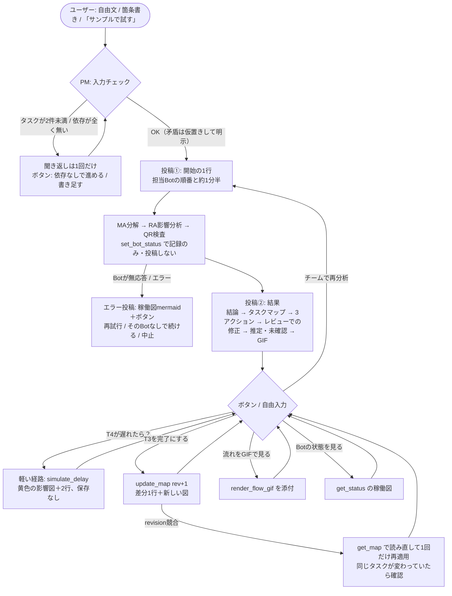

# TaMap UI/UX設計書（Grok Botチャット内体験）

対象：ユーザーが **TaMap PM（Grok BotのメインBot）だけ** と話し、入力 → Bot連携の表示 → 結果 → 追加質問 までをチャット内で完結させる体験。
前提：送信済みメッセージは書き換えられない。表示できるのは Markdown、mermaid、画像/GIF添付、質問ウィジェット（選択肢ボタン最大6・自由入力可）、絵文字リアクションだけ。外部Web UIは使わない。表は使わない。
（作成 2026-10-11 13:45 JST ごろ。ハッカソン開始から約1時間半の時点）

---

## 1. 体験の原則

1. **1回の分析で投稿は2つだけ。** 開始の1行と結果の1通。Botが切り替わるたびの稼働図は投稿しない。途中の状態は `set_bot_status` で記録だけしておき、結果の **GIF 1本** でまとめて見せる（チャットが伸びない／書き換えできない制約にも合う）。
2. **光るのは「今作業しているBot」1体だけ。** PMは依頼を出したら待機（灰）に戻す。PMが光るのは「受付」と「統合」のときだけ。
3. **結論が先、根拠は後。** 結果の1行目は「何がボトルネックで、次に何をするか」。図・修正履歴・仮定はその下に置く。
4. **事実・推定・未確認を分けて書く。** コード（TaMap Core）で計算した事実（影響先・合流点・循環）には印を付けない。Botの推定には「（推定）」を付け、未入力の数値（日数・工数）は出さずに「未確認」とまとめる。
5. **次の一手はボタンで出す。** 結果の最後には必ず質問ウィジェット（最大6択）を付ける。What-ifは「軽い経路」（PMがツールを1回呼ぶだけ、約10秒）で返し、チーム全体の再分析（約1分半）はボタンで選んだときだけ行う。

---

## 2. ユーザーフロー



---

## 3. 入力のUX

### 3.1 入力の受け方
- **自由文**：「タスク管理アプリ作ってて、要件とUIは終わり、DBは途中…」→ Map Architect がT番号を振る。PMは結果の中で「T番号はTaMapが振りました」と1行添える。
- **箇条書き**：READMEの形式（`T1 要件整理：完了、依存なし`）をそのまま受け付ける。IDはユーザーのものを使う。
- **サンプル起動ボタン**：最初の挨拶、または入力が空・曖昧なときに出す。

最初の挨拶（PMが最初に出す、または「TaMap」と呼ばれたとき）：
````text
TaMap PM です。タスクと依存関係を送ってください。Map Architect・Risk Analyst・Quality Reviewer の3体で、ボトルネック・遅延の影響・次の3アクションを出します（約1分半）。
書き方は自由です。例：「T4 API実装：未着手、T3に依存」
[ボタン] サンプル（タスク管理アプリ T1〜T7）で試す ／ わざと矛盾を入れたサンプルで試す ／ 書き方の例を見る
````
- 「サンプルで試す」を押すと README の入力例の全文がユーザー発言として返る（ボタンの文 ＝ 入力そのもの）。そのため、ボタンの文言は「サンプル（タスク管理アプリ T1〜T7）で試す」とし、PMの指示文に、この文を受けたら `samples/readme_example.json` の内容を使うと書いておく。

### 3.2 情報が足りないとき（聞き返しは最大1回）
- タスクが2件未満 → 聞き返す：「タスクをあと何件か教えてください」＋ボタン［サンプルで試す］。
- 依存関係が1つも書かれていない → 聞き返す：「依存関係が書かれていません。どうしますか？」＋ボタン［順番どおりに依存させる（推定）］［依存なしとして分析する］［書き足す（自由入力）］。
- 状態が書かれていない → 聞き返さない。「未着手」とみなし、結果の「推定・未確認」に書く。
- 期限・工数が無い → 聞き返さない。日数の影響は計算しない（「未確認：工数・期限が未入力のため日数影響は未算出」）。

### 3.3 入力に矛盾があるとき（聞かずに仮置きし、明示してワンタップで戻せるようにする）
- 例：「T4 未着手」なのに「T4はDB待ちで止まっている」→ **T4をブロック中として扱う**。結果の結論の直下に1行：
  `⚠️ 入力の矛盾：T4は「未着手」とありましたが「止まっている」とあったため、ブロック中として扱いました。`
  ボタンに［T4を未着手に戻す］を追加する。
- 完了タスクの依存先が未完了（`△依存先未完了`）→ 図の警告ラベルのまま見せ、「推定・未確認」に1行書く。止めない。
- 存在しない参照・循環・重複ID（検証エラー）→ 分析は止めず、図の赤ノード・赤破線のまま見せる。結論は「検証エラーN件、先に直すと分析が正確になります」とし、修正用のボタンを出す（6章）。

---

## 4. 各フェーズのメッセージ完成形

### 4.0 投稿数の上限
- 分析1回（MA→RA→QR）：**PMの投稿は2つまで**（①開始の1行 ②結果＋ボタン）。エラー時だけ、②の代わりにエラー投稿。
- What-if・状態変更・GIF・状態表示：**1つ**（＋ボタン）。
- mermaidは1投稿に**最大1ブロック**（タスクマップか稼働図のどちらか）。GIFは1投稿に最大1本。

### 4.1 進行中の見せ方（書き換えできない前提での比較）
- **A. Botが切り替わるたびに稼働図mermaidを投稿**（現状）：流れは分かるが、1周で6〜7枚の図になり結果が埋もれる。不採用。
- **B. 切り替わりごとに短文を1行ずつ投稿**（「🔵 Map Architect 作業中…」）：図は無いので軽いが、それでも4〜6投稿になる。90秒デモでは画面が流れて見づらい。不採用。
- **C. 開始時に1行＋完了時にGIF 1本（推奨）**：待っている間は「何が・どの順で・どれくらいかかるか」が1行で分かり、終わったらGIFで流れ全体を再生する。投稿は2つ。GIFは状態の履歴から作るので、書き換えできないことが問題にならない。
- **D. 開始時に稼働図を1枚＋完了時GIF**：全員待機の図に意味が無いので、Cの1行で十分。

推奨はC。開始の1行には絵文字リアクションは使わない（PMが自分の投稿にリアクションしても状態更新には見えないため）。

**投稿①（開始）の文言**：
````text
受け付けました。7タスクで分析します：🗺️ Map Architect（分解）→ ⚠️ Risk Analyst（影響）→ ✅ Quality Reviewer（検査）。約1分半かかります。終わったら流れをGIFでお見せします。
````

### 4.2 投稿②（結果）の要素順と完成形
要素順：①結論2行 ②（あれば）矛盾・検証エラーの1行 ③タスクマップmermaid（`create_map`/`update_map` の戻り値をそのまま貼る。下の revision 行も含める）④次の3アクション ⑤レビューでの修正 ⑥推定・未確認 ⑦GIF（添付）と参照の1行 ⑧ボタン。

````text
**結論：ボトルネックは T4 API実装（ブロック中）。T4 が遅れると T6 統合テスト・T7 リリースが止まります。**
まず T3 担当に T4 のブロック理由を確認してください。

```mermaid
graph LR … （create_map / update_map が返した図をそのまま貼る）
```
revision 3 ・ map_id `JbeSRnxW` ・ 更新 13:21:29 JST ・ 検証OK

**次の3アクション**
1. T3 担当に T4 のブロック理由を確認し、API 用のテーブル・列だけ先に確定して T4 を部分的に始める
2. T5→T4 の暗黙の依存があるか確認する。あれば API 仕様を先に固め、モックで進める（推定）
3. T6 は API 結合テストに絞り、UI 単体テストは T5 側で前倒しする

**✅ Quality Reviewer のレビューで直した点（2件）**
- 「T4 の遅れの原因は DB 設計」→「原因は DB 設計の可能性あり（推定・未確認）」に弱めた
- 「モックで並行開発する」→「T5→T4 の依存がある場合のみ」と条件を付けた

**推定・未確認**
- 工数・期限が未入力のため、日数の影響は計算していません
- 影響先（T6・T7）と合流点（T6）は TaMap Core の計算結果です（推定ではありません）

▶ 添付GIF：4体のBotの流れ（約29秒）。作業中のBotだけが光り、最後に T4→T6→T7 へ遅延の影響が広がります。
[GIF添付: /workspace/tamap/out/JbeSRnxW_flow.gif]
[ボタン] T4が遅れたら？ ／ T3を完了にする ／ チームで再分析 ／ 流れをGIFでもう一度 ／ Botの状態を見る
````
- GIFの添付位置はチャット側が決める可能性があるため、本文の「▶ 添付GIF」の1行で何のGIFかを説明する。
- GIF生成（10〜15秒）が失敗したら、GIFの行を「GIFは作れませんでした（［流れをGIFでもう一度］で再試行）」に差し替え、結果は止めない。
- ボタンの文は、押すとそのままユーザーの発言になる。だから「T4が遅れたら？」のように、自分で入力したときと同じ文にする。

### 4.3 「レビューで提案が直った」の見せ方
- 見出しは「Quality Reviewer のレビューで直した点（N件）」。各項目は **「直す前」→「直した後」** の1行（矢印でつなぐ）。理由が要る場合だけ、末尾に（断定しすぎ）（根拠が弱い）と付ける。
- 直した点が0件なら「✅ Quality Reviewer：指摘なし」の1行だけにする。
- データ：`analysis.quality.items` に `{text: 直した後, before: 直す前, reason}` を保存する（8章 P4）。GIFの「指摘N件 → PMが修正」バッジも同じ件数を使う。
- 3アクションの中で、レビューで直した項目には（推定）や条件の文言が残るので、結果の本文だけを見ても直したことが分かる。

### 4.4 What-if（「T4が遅れたら？」）— 軽い経路・1投稿
PMは `simulate_delay(map_id, "T4")` を1回呼ぶだけ。専門Botには回さない（約10秒）。保存しないので revision は変わらない。
````text
**T4 が遅れると、T6 統合テスト（1段先）と T7 リリース（2段先）が遅れます。** T6 は T5 との合流点なので、T5 が先に終わっても T6 は始められません。

```mermaid
graph LR … （simulate_delay の図。遅延元は太枠、影響は黄色）
```
revision 3 ・ map_id `JbeSRnxW` ・ what-if: T4（保存なし）

何日遅れるかは工数が未入力のため計算していません（未確認）。
[ボタン] T3が遅れたら？ ／ T4をブロック中として保存する ／ チームで再分析 ／ 元のマップに戻る
````

### 4.5 追加質問後の再分析（「T3を完了にする」）— 1投稿
PMが `update_map(expected_revision=現在)` を呼び、revision が1つ上がる。図の下の revision 行の上に **差分の1行** を置く。
````text
**rev 3 → 4 に更新：T3 DB設計 を「進行中 → 完了」にしました。** T4 は着手できる状態になり、ボトルネックは T4 のままです。

変更点：T3 進行中→完了 ／ ボトルネック：変化なし（T4）／ 影響先：変化なし

```mermaid
graph LR … （update_map の図）
```
revision 4 ・ map_id `JbeSRnxW` ・ 更新 13:58:10 JST ・ 検証OK

アクション1（T3 担当にブロック理由を確認）は不要になった可能性があります。3アクションを作り直すには［チームで再分析］を押してください。
[ボタン] チームで再分析 ／ T4が遅れたら？ ／ T4を進行中にする ／ 流れをGIFで見る
````
- 状態の変更は、事実の更新なので専門Botを回さない（PMだけで反映、約10秒）。アクションを作り直すときだけ［チームで再分析］で1周する（4.1と同じ2投稿）。
- 差分の1行は `update_map` の戻り値に含める（8章 P3）。それまではPMが前後の structuredContent を比べて書く。

### 4.6 「Botの状態を見る」— 1投稿
`get_status` の稼働図mermaidと直近の履歴をそのまま貼る。稼働図を出すのは、このボタンとエラー時の2つの場合だけ。

---

## 5. 結果の情報設計（まとめ）
1. 結論（太字1文＋次の一手1文）— 事実だけで書く
2. 矛盾・検証エラーの1行（あるときだけ、⚠️）
3. タスクマップ mermaid＋revision 行（ツールの戻り値をそのまま）
4. 次の3アクション（最大3件。ツール側でも4件以上は拒否される）
5. Quality Reviewer のレビューで直した点（直す前→直した後）
6. 推定・未確認（未入力の数値は出さない／Coreの計算結果である旨）
7. GIF（流れの再生。最後のフレームで3アクションをもう一度見せる）
8. ボタン（最大6、普段は5つ）

表示ルール：
- Botの推定には文中に「（推定）」を付ける。Coreの計算（影響先・合流点・循環・存在しない参照）には付けない。
- 日数・確率など、入力に無い数値は出さない。
- Bot名は絵文字＋英名で統一する（🗺️ Map Architect／⚠️ Risk Analyst／✅ Quality Reviewer）。

---

## 6. エラー・失敗時の見せ方（どれも1投稿＋ボタン）

**Botが応答しない（60秒経っても結果が返らない）**：PMは `set_bot_status(<bot>, error, "60秒応答なし")` を呼び、稼働図（そのBotが赤）を貼る。
````text
⚠️ Risk Analyst から60秒間応答がありません。ここまでの結果（Map Architect の分解）は保存済みです（revision 2）。
```mermaid
flowchart LR … （set_bot_status の稼働図。RA が赤）
```
[ボタン] Risk Analyst に再依頼する ／ Risk Analyst なしで続ける ／ 中止する
````
- 「なしで続ける」を選んだ場合、結果の結論の上に `⚠️ Risk Analyst の分析なし（影響先はCoreの計算のみ）` と書く。Quality Reviewer を飛ばした場合は「未レビュー」と書き、「レビューで直した点」の欄は出さない。

**検証エラー（存在しない参照・循環・重複ID）**：分析は止めずに結果を出す。結論は次の形にする。
````text
**検証エラーが3件あります（T9 が存在しない／T6⇄T7 が循環／T2 が重複）。** 赤いところを直すと、影響の分析が正確になります。
[ボタン] T9 への依存を削除する ／ T9 をタスクとして追加する ／ T7→T6 の依存を削除する ／ このまま分析を見る
````
- 修正のボタンを押したら `update_map` を呼び、4.5と同じ差分の1行を出す。

**revision競合（`revision_conflict`）**：PMは自動で `get_map` を呼んで読み直し、**1回だけ**再適用する。そのときは1行で知らせる：`他の更新（rev 5）を取り込んでから T3 を完了にしました（rev 6）。`
- 同じタスクがすでに別の内容に変わっていたら、再適用せずに確認する：`T3 はすでに「ブロック中」に更新されています（rev 5）。完了にしますか？`＋［完了にする］［そのままにする］。

**MCPツール自体のエラー／GIF生成失敗**：エラーの内容をそのまま1行で伝え（隠さない）、再試行のボタンを付ける。GIFの失敗だけなら、結果本体は普段どおり出す。

---

## 7. 90秒デモ台本

### 段取り（現実的な前提）
- 1周に約1分半かかり、GIFの生成にも10〜15秒かかるので、**本番では1周を回さない**。デモの直前（または前夜）に同じチャットでサンプル入力から1周を回しておき、結果の投稿②（GIF付き）まで出しておく。デモではそこから見せる。
- 本番でその場で行うのは **軽い経路だけ**（What-if：約10秒、T3完了：約10秒）。
- 予備：事前に録画した1周のGIF（`out/<map_id>_flow.gif`）と、ボタンを押す前のチャットのスクリーンショット。Grok Bot が無応答だった場合はこれに切り替える。
- 事前に、デモ用マップの `bot_history` が「PM受付 → MA → RA → QR → PM統合」の1周だけになっていることを確認する（不要な履歴が残っていると、GIFの字幕がずれる）。

### タイムライン
- **0–8秒**｜画面：チャットの最初、サンプル入力（T1〜T7）とPMの開始1行。ナレーション：「タスク一覧だけでは、どこが詰まるか分かりません。TaMap は Grok Bot の4体のチームで、それを地図にします。」
- **8–40秒**｜画面：投稿②のGIFを再生（約29秒）。PM→Map Architect→Risk Analyst→Quality Reviewer の順に1体ずつ光り、青い封筒（依頼）と黄色い封筒（結果）が行き来し、T4→T6→T7 が黄色に広がる。ナレーション：「話しかけるのは PM だけです。PM が分解・影響分析・品質チェックを順に頼みます。光っているのが今作業しているBotです。最後に Quality Reviewer が、断定しすぎた提案を2件直しています。」
- **40–55秒**｜画面：結果の本文を上にスクロール。結論・タスクマップ（▲ボトルネック、◆合流点）・3アクション・「レビューで直した点：直す前→直した後」。ナレーション：「結論が最初に来ます。ボトルネックは T4。推定と未確認は分けて書いてあります。」
- **55–70秒**｜操作：［T4が遅れたら？］を押す → 約10秒で黄色の影響図が出る。ナレーション：「What-if はボタン1つです。影響の範囲はLLMではなく、コードで計算しています。保存はしないので revision は変わりません。」
- **70–85秒**｜操作：［T3を完了にする］を押す → 「rev 3 → 4」と差分の1行、更新されたマップが出る。ナレーション：「状態を変えると、同じマップの revision が上がります。古い revision からの更新は拒否されます。」
- **85–90秒**｜画面：ボタンの並び。ナレーション：「タスクをつなぎ、未来を描く。TaMap でした。」

READMEの検証チェックリストとの対応：Bot間の引き継ぎ（GIF）、検証（矛盾入りサンプル。時間に余裕があれば質疑で見せる）、到達可能な後続（What-if）、QR指摘の反映（直す前→直した後）、同じIDのrevision更新（T3完了）、90秒以内（この台本）。「URL」「view_id」は「map_id」に読み替える（8章 P7）。「認証なしで書き換えられない」は「stdio MCP を起動できる人だけが書ける」ことまでしか言えないので、正直にそう書く。

---

## 8. 実装への変更リスト（優先度順・残り約2時間半で行う分）

- **P0（15分）疎通確認｜Grok Bot のチャット**：`create_map` の mermaid（classDef/linkStyle/`<br>`）が描画されるか、`out/JbeSRnxW_flow.gif` を添付して再生できるか確認する。描画されなければ、render.py の `<br>` を半角スペースに変え、色は classDef だけ残す。GIFが再生できなければ、GIF から3〜4フレームを PNG に取り出して静止画として添付する（現在の `render_flow_gif` は `out/{map_id}_flow.gif` だけを書き、PNG のフレームは出力しない）。
- **P1（25分）PMの指示文を書き直す｜TaMap PM の Bot 指示文**：①1回の分析で投稿は2つ（開始の1行・結果）、途中の稼働図は投稿しない ②結果の要素順と文言テンプレート（4.2）③結果の最後には必ず質問ウィジェット（4.2のボタン5つ）④What-if と状態変更は軽い経路（simulate_delay／update_map のみ、専門Botを回さない）⑤聞き返しは最大1回、矛盾は仮置きして⚠️の1行（3章）⑥専門Botに依頼した直後に `set_bot_status(pm, idle, "<Bot>の結果待ち")` ⑦60秒無応答のときのエラー処理と、revision競合のときに1回だけ再適用（6章）⑧ボタンの文「サンプル（タスク管理アプリ T1〜T7）で試す」を受けたらREADMEの入力例を使う。
- **P2（15分）光るのを1体にする｜`tamap/store.py` set_bot_status、`tests/e2e_mcp.py`**：pm 以外のBotが `working` になったら、pm を自動で `idle`（note「結果待ち」）にする（P1の指示文に頼らず、コード側で保証する）。`tamap/animate.py` もPMの依頼の後はPMを待機で描くようにする。テストを1件追加する。
- **P3（20分）revisionの差分の1行｜`tamap/store.py` update_map、`tamap/render.py`**：前のスナップショット（history）と比べ、`変更点：T3 進行中→完了 ／ ボトルネック：T3→T4 ／ 影響先：変化なし` を revision 行の上に出す。structuredContent に `diff` を入れる。e2e に1件追加する。
- **P4（10分）レビューで直した点の保存｜`tamap/store.py` `_normalize_item`、QR・PMの指示文**：`before` キーを通す。QRには「指摘ごとに before（元の文）／text（直した文）／reason を返す」と指示する。`animate.py` のバッジの件数は items の件数を優先する。
- **P5（20分）デモの準備｜データとリハーサル**：新しいマップでサンプル入力から1周を回し（P1・P2の反映後）、GIFを作り直す。`bot_history` が1周分だけであることを確認する。台本どおり2回通しでリハーサルし、時間を計る。予備のGIFとスクリーンショットを保存する。
- **P6（10分）専門Botの指示文｜Map Architect／Risk Analyst／Quality Reviewer**：結果は短く（MA：タスクとstatusの変更点、RA：影響の起点のIDと対処案3件、QR：before/after形式の指摘）。PMの前で長文を書かない。入力に無い数値は出さない。
- **P7（10分）READMEの整合｜`README.md`**：URL／view_id を map_id／revision に置き換え、チェックリストの項目を、チャット内で完結する現在の方式に合わせて書き直す（「Mainから画面URLを取得」→「Mainからmap_idと最新の図を取得」）。動作を確認したことだけにチェックを付ける。
- **追加（2026-10-11、Yuu さんの決定）閲覧専用のライブページ**：`bot_history` に合わせて 4 体のドット絵が動く `/live/{map_id}`（`docs/LIVE_VIEW.md`）。チャット内完結の例外だが、この設計書のチャットの流れ（投稿 2 つ、結果の GIF）は変えない。
- **後回し（今回はやらない）**：エラー用のボタンの自動生成、日数の計算、GitHub連携、定期実行での再評価。
