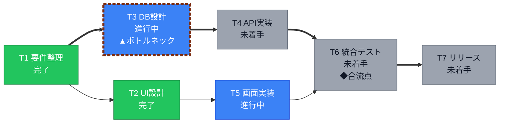
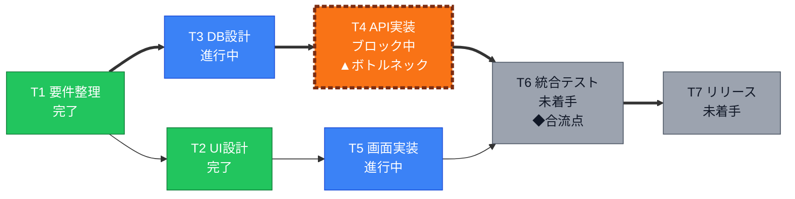
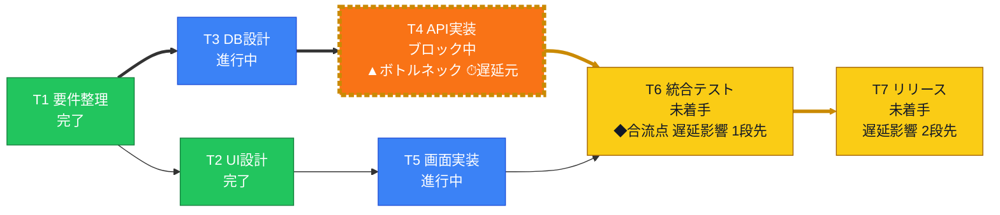
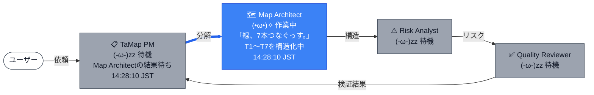
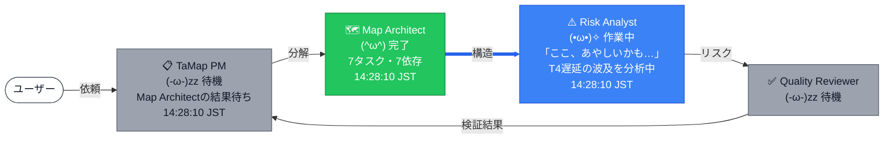
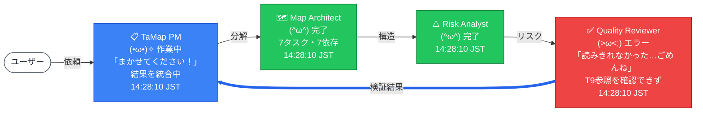
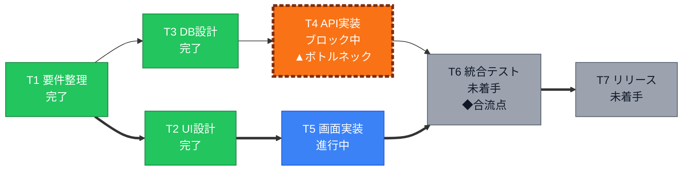
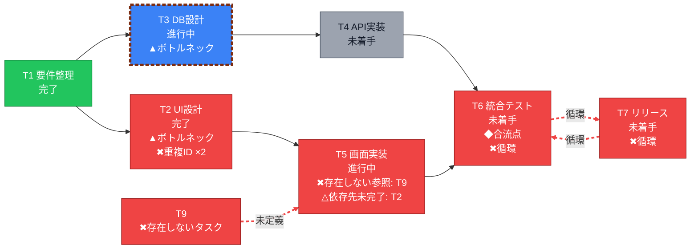
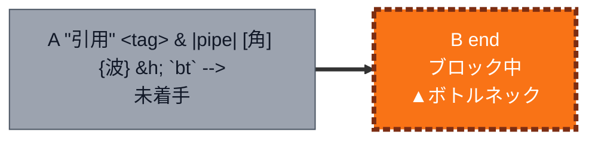

# TaMap MCP 出力サンプル

`tests/e2e_mcp.py` が stdio MCP サーバーを公式 mcp クライアントで実際に呼び、各ツールが返したチャット用テキスト（mermaid）をそのまま貼ったものです（自動生成）。時刻は実行時のもの。

## create_map（README例）

revision 1 ・ map_id `eq9K0EQI` ・ 更新 14:28:10 JST ・ 検証OK

---

## update_map（T4をブロック中に）

変更点：T4 未着手→ブロック中 ／ ボトルネック：T3→T4 ／ 影響先：T4・T6・T7→T6・T7

revision 2 ・ map_id `eq9K0EQI` ・ 更新 14:28:10 JST ・ 検証OK

---

## update_map（古いrevisionで更新 → 拒否）

エラー: revision conflict: map eq9K0EQI は revision 2 です（expected_revision=1）。 get_map で最新状態を読み直してから再度 update_map してください。

---

## get_map

revision 2 ・ map_id `eq9K0EQI` ・ 更新 14:28:10 JST ・ 検証OK

---

## simulate_delay（T4）

revision 2 ・ map_id `eq9K0EQI` ・ 更新 14:28:10 JST ・ 検証OK ・ what-if: T4（保存なし）

---

## set_bot_status（MA作業中 → PMは自動で待機）

map `eq9K0EQI` のBot稼働状況 ・ 直近の変更（新しい順）:
- 14:28:10 Map Architect: 作業中（T1〜T7を構造化中）
- 14:28:10 TaMap PM: 待機（Map Architectの結果待ち）
- 14:28:10 TaMap PM: 作業中（依頼を受付）

---

## set_bot_status（Risk Analyst 作業中）

map `eq9K0EQI` のBot稼働状況 ・ 直近の変更（新しい順）:
- 14:28:10 Risk Analyst: 作業中（T4遅延の波及を分析中）
- 14:28:10 Map Architect: 完了（7タスク・7依存）
- 14:28:10 Map Architect: 作業中（T1〜T7を構造化中）
- 14:28:10 TaMap PM: 待機（Map Architectの結果待ち）
- 14:28:10 TaMap PM: 作業中（依頼を受付）

---

## set_bot_status（PM統合中・QRエラー）

map `eq9K0EQI` のBot稼働状況 ・ 直近の変更（新しい順）:
- 14:28:10 TaMap PM: 作業中（結果を統合中）
- 14:28:10 Risk Analyst: 完了
- 14:28:10 Quality Reviewer: エラー（T9参照を確認できず）
- 14:28:10 Risk Analyst: 作業中（T4遅延の波及を分析中）
- 14:28:10 Map Architect: 完了（7タスク・7依存）

---

## get_status

map `eq9K0EQI` のBot稼働状況 ・ 直近の変更（新しい順）:
- 14:28:10 TaMap PM: 作業中（結果を統合中）
- 14:28:10 Risk Analyst: 完了
- 14:28:10 Quality Reviewer: エラー（T9参照を確認できず）
- 14:28:10 Risk Analyst: 作業中（T4遅延の波及を分析中）
- 14:28:10 Map Architect: 完了（7タスク・7依存）

---

## update_map（T3を完了に・差分の1行）

変更点：T3 進行中→完了 ／ ボトルネック：変化なし（T4） ／ 影響先：変化なし（T6・T7）

revision 3 ・ map_id `eq9K0EQI` ・ 更新 14:28:10 JST ・ 検証OK

---

## render_flow_gif

▶ 流れのGIF: `/tmp/tamap-e2e-9reh9y4n/out/eq9K0EQI_flow.gif`（約23秒・Bot履歴9件）

---

## render_team_card

▶ チーム紹介のGIF: `/tmp/tamap-e2e-9reh9y4n/out/tamap_team.gif`

---

## create_map（不整合サンプル）

revision 1 ・ map_id `hrl18AyT` ・ 更新 14:28:14 JST ・ 検証エラー3件

---

## create_map（記号入りタイトルのエスケープ確認）

revision 1 ・ map_id `d9civqJW` ・ 更新 14:28:14 JST ・ 検証OK

---

## list_maps

- `hrl18AyT` デモ用：不整合入りサンプル（Quality Reviewer検出デモ）（revision 1、更新 14:28:14 JST）
- `d9civqJW` Q"uote <b> & |x| [y] `z` end（revision 1、更新 14:28:14 JST）
- `eq9K0EQI` タスク管理アプリ開発（README入力例）（revision 3、更新 14:28:10 JST）

---
